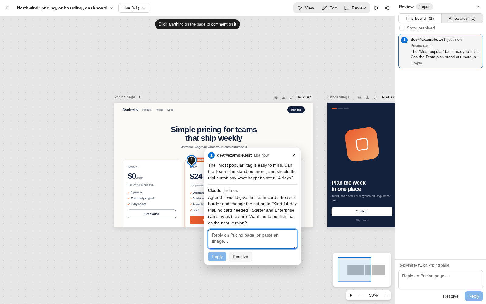

# Artifact Hub

A self-hosted home for what your AI tools build. Any MCP client, from Claude to an agent you wrote yourself, publishes pages and
design canvases to the hub. You and your team open them in the browser and comment on the page. The AI reads each comment and replies.
Everything is stored in one SQLite file on your own server.

[Landing page](https://czepter.github.io/artifact-hub/) · [Reference](docs/reference.md) · [MIT license](LICENSE)



## What you get

- **A review loop the AI takes part in.** Comments are pinned to an element on the page. The AI reads them, replies, fixes the page and resolves the thread.
- **Versions.** Every change is saved as a new version. You can compare versions and go back.
- **A canvas for boards.** Pages sit side by side on an infinite wall. Focus one, present them in order, or edit in place with layers and properties.
- **Click dummies.** Wire boards into a clickable prototype with plain attributes or the editor's Prototype panel. Hotspots go to other boards with a transition and a back stack. Components have states for hover, press, focus and open, and selects, radios and checkboxes can drive them. Actions can depend on a field (`go:Cart.html if #email:valid & #terms:checked`). Dialogs, drawers, sheets and popovers open over a board, and a flow view draws the links between boards. Try it in play or present mode.
- **Sharing.** View-only or comment links for guests, who need no account. Members have the role owner, editor or commenter.
- **Control over the AI.** When you connect a tool, you choose what it may do: read, comment, publish and edit, or share. It never gets more rights than you have.
- **Extras.** Interactive pages that store data, workspaces with files shared between boards, PNG and SVG export, and `.zip` export and import.

## Quick start

You need Docker, or Node 24 or newer.

```bash
docker run -d --name artifact-hub -p 3000:3000 -v artifact-hub:/data \
  -e NUXT_BASE_URL=https://hub.example.com \
  ghcr.io/czepter/artifact-hub:latest
```

With Docker Compose, use the [`docker-compose.yml`](docker-compose.yml) in this repo. To run from source:

```bash
git clone https://github.com/czepter/artifact-hub.git
cd artifact-hub
npm install
npm run dev      # http://localhost:3000
```

Open the hub and create the owner account on the sign-in page. The first account is the owner. After that, people join by invitation:
the owner creates an invite link under **Members** and sends it.

For real use, serve the hub over HTTPS and set `NUXT_BASE_URL` to its public address. Passkeys only work over HTTPS or on `localhost`.

## Connect an AI tool

Add `https://<your host>/mcp` to your AI tool as an MCP server. In Claude this is a custom connector. The tool registers itself,
sends you to the hub to sign in, and shows a consent screen where you pick what it may do. The hub has a `guide` tool that tells the AI how to structure
artifacts, so you can start by asking it to publish something.

A grant belongs to the member who approved it. You can review and revoke grants under **Account**, and the owner sees all of them under **Admin**.

## Configuration

All settings are environment variables. None are required to try it out.

| Variable | What it does |
|---|---|
| `NUXT_BASE_URL` | The public address, for example `https://hub.example.com`. Set it when the hub runs behind a reverse proxy, so sign-in links and passkeys use the right address. |
| `NUXT_SESSION_SECRET` | Signs sessions. If unset, the hub generates one and stores it next to the database in `auth-secret`. |
| `NUXT_GITHUB_CLIENT_ID`, `NUXT_GITHUB_CLIENT_SECRET` | Turn on "Sign in with GitHub". Both are needed. The callback URL is `<base>/api/auth/callback/github`. |
| `HUB_DB` | Path of the SQLite database file. By default the hub creates it in a `.data` folder next to where it runs. The Docker image stores it in the `/data` volume. |

To back up the hub, copy the database file and `auth-secret` from the data directory (the `/data` volume in Docker).
To update, pull the new image and restart the container. The data stays in the volume.

Boards are drawn as text outlines unless the server has a browser to render them. For real pictures in PNG and SVG exports, build the image with
Chromium: `docker build --build-arg WITH_CHROMIUM=1 .` (details in the [reference](docs/reference.md#rendering-png-svg-webp-jpeg-xml)).
To deploy on Coolify, use [`docker-compose.coolify.yaml`](docker-compose.coolify.yaml).

## Development

```bash
npm install
npm run dev:login   # dev server that signs every request in, no account needed
npm run test:unit   # canvas, geometry, HTML-edit and rendering tests
```

`dev:login` accepts the bearer token `devtoken` on the API and on `/mcp`, which is handy for scripts and tests. It only works in
`nuxt dev`. A production build ignores it and refuses to start if `NUXT_DEV_LOGIN_EMAIL` or `NUXT_DEV_TOKEN` is set, so never set them on a deployed instance.

The API tests in `tests/*.mjs` run against a dev-login server. For example, start `PORT=3111 npm run dev:login`, then run `node tests/workspaces-test.mjs`.
`node scripts/seed-demo.mjs` publishes a sample design canvas with a comment thread to a running hub.

The stack is Nuxt 4, shadcn-vue on reka-ui, Tailwind v4 and SQLite (Node's built-in `node:sqlite`). See [CONTRIBUTING.md](CONTRIBUTING.md) before opening a pull request.

## Known gaps

- There is no rate limiting on `/oauth/register` and `/oauth/token`. Put a limit in front of them in your reverse proxy.
- Invitations are links, not e-mails. There is no password reset by e-mail and no e-mail verification.
- Guests who comment give an e-mail address that is not verified.
- Templates for documents, slides and dashboards do not exist yet. The canvas is the only structured type.
- Behind some reverse proxies the live updates need response buffering turned off for `/api/view/*/events`. This has not been tested through a real proxy.

The full list is at the end of the [reference](docs/reference.md#not-done-yet).

## Documentation

- [Reference](docs/reference.md): MCP tools, workspaces, shared files, rendering, admin, interactive pages, the viewer and editor, import.
- [PRODUCT.md](PRODUCT.md) and [DESIGN.md](DESIGN.md): what the product is for and how the interface looks.
- [Canvas upgrade plan](docs/canvas-plan.md): design notes behind the canvas editor.
- [SECURITY.md](SECURITY.md): how to report a vulnerability.

## License

[MIT](LICENSE). `shared/vendor/open-design/` is copied from [nexu-io/open-design](https://github.com/nexu-io/open-design) (Apache-2.0), see its `NOTICE.md`.
Artifact Hub is an independent project and is not affiliated with Anthropic.
